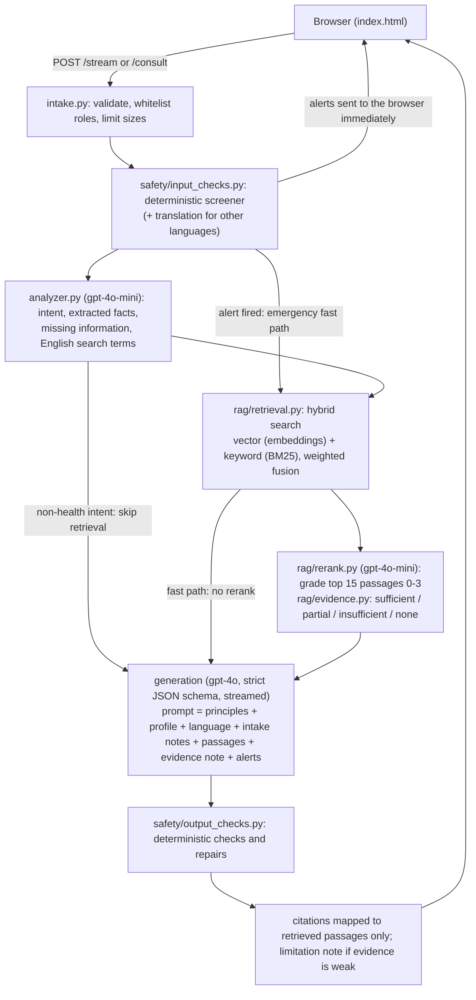

# Medi architecture

Medi is a health-information and wellbeing assistant. It is not a diagnostic system. This document describes how one
message is turned into an answer, and why each stage exists.

## Pipeline

Every stage is timed and recorded in a content-free trace (`medi/trace.py`). The orchestrator (`medi/orchestrator.py`)
only decides the order; each stage lives in its own module.

## Modules

| Module | Purpose |
|---|---|
| `medi/config.py` | All models, thresholds, and feature switches. `Pipeline` is one configuration; experiments compare several. |
| `medi/llm.py` | The only code that calls OpenAI: timeouts, retries for temporary failures (not for exhausted credits), token and cost accounting. |
| `medi/intake.py` | Request validation: only `user`/`assistant` messages, inline image data only, size limits. |
| `medi/safety/input_checks.py` | Deterministic red-flag screener (emergencies, crisis, abuse, overdose), with negation handling. |
| `medi/safety/escalation.py` | What happens when a check fires, including the guaranteed 9-8-8 crisis line. |
| `medi/safety/output_checks.py` | Checks every answer: citation validity, crisis line, no percentages, no specific doses, no unjustified certainty, emergency replies start with the action, level vs. screener alert. |
| `medi/analyzer.py` | One small-model call: intent, structured extraction (symptoms, duration, severity, context, already answered, missing), search terms. This is the per-turn conversation state; it is rebuilt each turn and never stored. |
| `medi/rag/ingestion.py`, `chunking.py` | Download sources with their real metadata; sentence-aware chunks with overlap; exact-duplicate removal. |
| `medi/rag/index.py`, `bm25.py`, `retrieval.py` | Load the index; keyword search; vector, keyword, or hybrid retrieval with per-topic diversity. |
| `medi/rag/rerank.py`, `evidence.py` | Small-model relevance grades; evidence-sufficiency status and what the generator is told about it. |
| `medi/rag/citations.py` | Shows passages to the model and maps its citation numbers back to retrieved records only. |
| `medi/orchestrator.py` | Runs the stages in order, for both streamed and one-shot answers. |
| `medi/services.py` | Visit summary, read-aloud speech, live voice-call setup. |
| `medi/web.py` | HTTP handling shared by the local server and Vercel functions: validation errors, rate limiting, developer access, structured logs. |
| `api/*.py` | Thin Vercel entry points (one per endpoint). |
| `server.py` | Local development server. |
| `dev.html` | Developer dashboard (needs `MEDI_DEV_TOKEN`). |

## Key design decisions

**Safety never waits for, or depends on, a language model.** The screener is regular expressions. Its alerts are streamed
to the browser before retrieval or generation start (39 ms in a local test, down from about 1.4 s in v1). When it fires,
the analyzer and reranker are skipped so the emergency answer isn't delayed. The model is told about the alert and the
browser opens the emergency or crisis screen on its own.

**Hybrid retrieval with mode-specific weighting.** Keyword search finds exact terms (drug and test names) that embeddings
rank too low; embeddings handle everyday wording. On the retrieval benchmark, weighted fusion at 70% vector beat both
methods alone and reciprocal-rank fusion. Wellbeing messages are everyday language, so their keyword weight is lower (10%).

**Reranking was kept because it measurably helps.** Precision@5 rose from 0.60 to 0.65 and MRR from 0.83 to 0.86-0.88.
It costs about 1.4 s per answer, which is reported as a trade-off rather than hidden.

**Evidence sufficiency comes from reranker grades, not raw similarity.** Cosine similarity barely separated good from bad
retrieval on the benchmark (hit rates of 93-98% across all score bands). The reranker's best grade did: "sufficient" answers
had a relevant topic 98% of the time, and 11 of 12 unanswerable questions were not rated sufficient. When evidence is weak,
irrelevant passages are withheld, the generator is told not to present specifics as sourced, and the person sees a note.

**900-character chunks with one sentence of overlap.** 600-character chunks had the best precision and 1,200-character
chunks the best coverage, but a held-out split showed the top settings are statistically indistinguishable; 900 uses about
25% fewer prompt tokens than 1,200.

**No new dependencies.** Everything is Python standard library, so the Vercel functions stay small and the code is easy to
audit. BM25, fusion, and evaluation metrics are implemented directly.

**Stateless server.** Nothing about a conversation is stored on the server. The browser sends the conversation each turn;
the analyzer rebuilds the conversation state from it.

## Knowledge base

- 1,016 MedlinePlus health topics (public domain) and 62 clinical guideline summaries (bshepp/clinical-decision-support-agent,
  Apache-2.0), pinned in `rag/sources.json` (MedlinePlus snapshot generated 2026-10-31).
- 3,881 passages after chunking and removing 13 exact duplicates. Each passage keeps its document id, chunk index, source,
  type (health topic or guideline summary), URL, section heading, MedlinePlus groups, and alternate names. Dates come from the
  source files only (MedlinePlus `date-created` and the snapshot's `date-generated`); guideline summaries carry no date.
- Embeddings: `text-embedding-3-small`, 256 dimensions. Rebuild with `python rag/build_index.py`.
- The v1 index (`rag/medi_index_v1.json`) is kept for the baseline experiment.

## Configuration

`medi/config.py` holds every setting. Environment variables: `OPENAI_API_KEY` (required), `MEDI_DEV_TOKEN` (enables the
developer trace and dashboard), `DOCTOR_MODEL`/`OPENAI_MODEL`, `RAG_REWRITE_MODEL` (helper model), `REALTIME_MODEL`,
`REALTIME_VOICE`, `TTS_MODEL`, `MEDI_RAG=0` (turn off retrieval), `MEDI_LLM_RETRIES`, `MEDI_LOG=0` (silence logs).

## Voice calls

Voice uses OpenAI's Realtime API over WebRTC. The browser calls `/screen` (the same deterministic screener) and `/retrieve`
(hybrid retrieval without the analyzer and reranker, to keep spoken replies fast) before each spoken reply, and `/consult`
to fill the assessment panel. The voice model receives the passages and any alerts as system messages.
