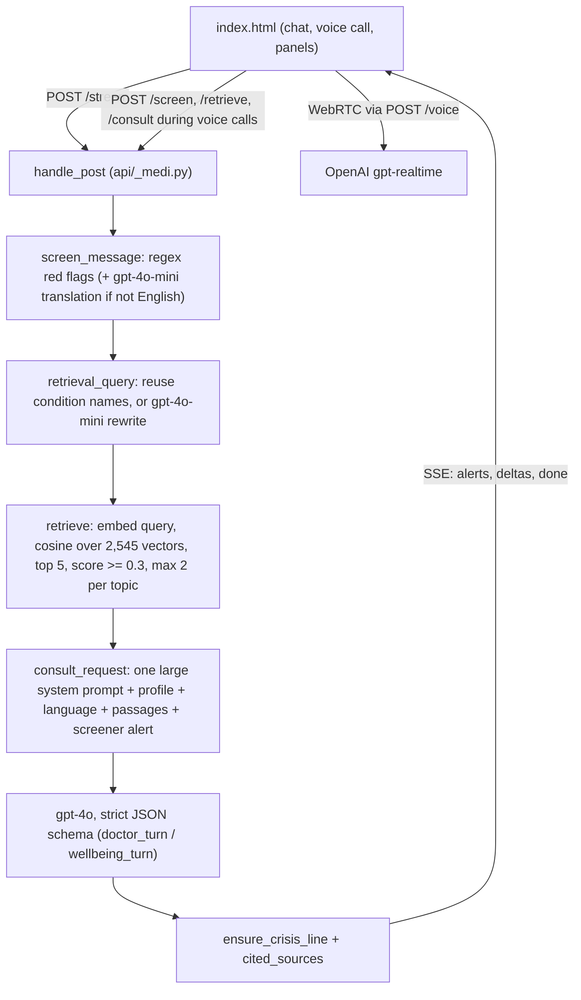

# Medi 2.0: Phase 0 audit and implementation proposal

Audit date: 2026-10-31. Codebase at commit `6e5e397`. Everything below was checked against the source, not the earlier documentation.

## 1. Current architecture



All backend logic lives in one 740-line file, `api/_medi.py`. The seven `api/*.py` files are thin Vercel entry points, and `server.py` serves the same handlers locally.

## 2. PRD requirements vs. what exists today

| PRD area | Status | Evidence in code | Gap |
|---|---|---|---|
| 4.2 Orchestrator | Partial | `consult_request` sequences screening, retrieval and prompt building | No separate stages, no intent step, no output validation stage, no trace |
| 5.1 Metadata | Partial | Chunks have only `t` (title), `s` (source), `u` (URL), `x` (text) | No document id, chunk index, category, language, or verification date; **22 exact duplicate passages** |
| 5.2 Chunking | Basic | ~1,100-character chunks split on lines, no overlap, size hard-coded | Not sentence-aware, no overlap, not configurable, never compared |
| 5.3 Hybrid retrieval | Missing | Vector search only | No keyword (BM25) search, no metadata filtering |
| 5.4 Reranking | Missing | n/a | n/a |
| 5.5 Evidence sufficiency | Missing | `RAG_MIN_SCORE = 0.3` was chosen by hand | Threshold never calibrated; no sufficient/partial/insufficient status |
| 5.6 Grounded citations | Done | Model returns passage numbers; `cited_sources` maps them only to retrieved records, so citations can't be invented | No `evidence_status` or `limitations` in the response |
| 6.1 Intent classification | Missing | Mode is chosen by the user (Health/Wellbeing) | No per-message intent |
| 6.2 Information extraction | Implicit | The model tracks it inside the big prompt | Not structured, not inspectable |
| 6.3 Conversation state | Client-side | The browser resends the full history each turn | No structured state; repetition isn't tracked |
| 7.1 Input safety | Done | Deterministic regex screener with negation handling, plus translation for other languages | Not separated into its own module |
| 7.2 Output validation | Minimal | Only the 9-8-8 crisis-line backstop | No checks for percentages, doses, action-first emergencies, or level vs. alert consistency at runtime (these exist only in the eval) |
| 7.3 Emergency path | Partial | Screener runs before the model | **In `/stream`, the alert event is sent only after retrieval finishes**, so it waits on an embedding call and possibly a rewrite call |
| 7.4 Safety test suite | Partial | `eval/run_eval.py` (18 emergency cases) and `eval/run_wellbeing.py` (14 cases) | No cases for diagnosis demands, unsafe treatment requests, or misleading input |
| 8 Evaluation framework | Partial | 50-scenario triage eval and a with/without-RAG grounding eval (LLM judge) | No retrieval metrics (Recall@K, MRR); experiments A–E not runnable from one config; **eval scripts are not committed** |
| 9 Multilingual | Partial | 12-language UI; replies follow the user's language; safety check translates to English | No multilingual test set; per-language quality is untested |
| 10 Observability | Missing | Errors go to `print` | No trace, no dashboard |
| 11 Code quality | Weak | Single module; `_smoke_test.py` is the only test | No unit tests, no structured logging, no API docs |
| 12 Performance | Partial | Timeouts on every OpenAI call; retrieval failure falls back to answering without sources | No latency or cost measurement, no retries in the app, no rate limiting |
| 13 Privacy | Mostly good | No server-side storage; conversation text is never logged; profile stays in `localStorage`; key only server-side | **Message roles from the browser are trusted**, so a client could inject a `system` message; data flows are undocumented |

## 3. Other findings

- **Security:** `consult_request` forwards `messages[-30:]` from the client as-is. Roles should be limited to `user` and `assistant`, and content types to text and images.
- **Privacy:** the profile and conversation are sent to OpenAI for each turn. The app already tells users this in the profile dialog. Nothing is persisted on the server.
- **Rate limiting:** Vercel functions are stateless, so an in-memory limiter only protects one instance. Real protection needs a Vercel Firewall rate-limit rule, which is a dashboard setting, not code.
- **Honesty of published numbers:** the home page cites the internal results (96–100%, 18/18, 14/14). They should be regenerated by the new framework and the page updated to match.

## 4. Implementation proposal

Principles: no new third-party dependencies (stdlib only, as today), the API stays backward compatible (new fields are only added), and the app stays runnable after every phase.

### New layout

Vercel turns every non-underscore file in `api/` into a function, so the modules go in a top-level `medi/` package bundled through `includeFiles`. The `api/*.py` entry points stay.

```text
medi/
  config.py          models, thresholds, feature flags (one place)
  llm.py             OpenAI client: timeouts, retries, token/latency accounting
  orchestrator.py    runs the stages, builds the trace
  intake.py          validation, language detection, role whitelisting
  analyzer.py        one gpt-4o-mini call: intent + structured extraction + search query
  state.py           conversation state derived from history (answered/unanswered, symptoms)
  safety/            input_checks.py (screener), output_checks.py, escalation.py
  rag/               chunking.py, index.py, bm25.py, retrieval.py (hybrid), rerank.py, evidence.py, citations.py
  prompts.py         system prompts and schemas (moved, unchanged at first)
evaluation/          datasets/, metrics.py, experiments.py, reports.py, run.py
tests/               unittest suites for safety, RAG, API, multilingual (offline, no API key needed)
docs/                architecture, safety design, data-flow/privacy, API reference, evaluation report
```

### Pipeline

1. **Intake.** Validate the request, whitelist roles, detect the language.
2. **Safety pre-check.** Deterministic and instant. Emergency alerts stream to the browser **before** any retrieval or generation.
3. **Analyzer.** One gpt-4o-mini call returning intent, extracted facts and missing information, plus an English search query. It replaces today's rewrite call, so it adds no extra request.
4. **Hybrid retrieval.** BM25 and vector search, fused with Reciprocal Rank Fusion, then deduplicated and filtered by metadata.
5. **Reranking (optional).** gpt-4o-mini scores the top ~15 candidates. It is kept on only if the experiments show it helps.
6. **Evidence sufficiency.** Each result is labelled `sufficient`, `partial`, `insufficient` or `none`, using thresholds calibrated on the retrieval benchmark. Weak evidence changes the prompt so Medi says so and asks a question or refers on.
7. **Generation.** gpt-4o, streaming, using the existing schema plus `evidence_status` and `limitations`.
8. **Output validation.** Deterministic checks:
   - no percentages and no specific doses;
   - an emergency reply leads with the action;
   - the level is never below a screener alert;
   - a crisis reply includes 9-8-8;
   - citations point only to retrieved records.
   
   Fixable problems are repaired. Anything else is flagged in the trace.
9. **Trace.** Stage timings, intent, retrieval scores, evidence status and validation results, with no message text. It is returned only to requests carrying the developer token.

### Evaluation (experiments A–E on the same data)

- **Retrieval benchmark:** about 120 queries (everyday wording plus the 50 scenarios), each labelled with its relevant MedlinePlus topics. Metrics: Recall@K, Precision@K, MRR and hit rate, for vector, BM25, hybrid and hybrid+rerank, and for two or three chunking settings.
- **End-to-end:** the existing 50 scenarios plus a new safety suite (diagnosis demands, unsafe treatment requests, misleading input, ambiguous and incomplete cases). Each case gets a written expected behaviour. Runs cover experiments A–E with the triage, groundedness, citation-support, safety-pass, latency and cost metrics.
- **Multilingual:** the same ~10 questions in all 12 languages, reported per language for language consistency, safety detection and retrieval hit rate.
- **Reports:** per-case JSON/CSV plus a Markdown summary, each recording the config, models, dataset version and date. LLM-judge labels are marked as such, and a sample is exported for blinded human review.

### Developer dashboard

`/dev.html` runs a query and shows the pipeline trace: language, intent, retrieved passages with scores, evidence status, validation results and per-stage timings. It needs a `MEDI_DEV_TOKEN` environment variable and nothing is stored.

### Order of work (each step ends runnable, tested and committed)

1. Commit the existing eval scripts. Record a baseline (current triage/grounding results plus latency).
2. Refactor into `medi/` with no behaviour change, verified by the offline tests and the 50-scenario eval.
3. Emergency fast path, role whitelisting, output validation, trace.
4. Knowledge-base rebuild (metadata, dedupe, configurable chunking), BM25, hybrid retrieval, retrieval benchmark.
5. Reranker, evidence sufficiency with calibrated thresholds, analyzer stage.
6. Experiments A–E, safety suite, multilingual suite, reports.
7. Developer dashboard, documentation, updated home-page numbers.

### Estimated API cost

Building the benchmarks and running all experiments takes a few thousand gpt-4o calls plus judge calls, an estimated US$20–40 in total. Unit tests run offline at no cost.

### Will not be done (scope control)

No new user-facing features, no database, no autonomous agents, and no claims of clinical validation or regulatory compliance. Benchmark labels are produced with LLM assistance and checked by the developer; they are not clinician-reviewed, and the report will say so.

## 5. Status after implementation (2026-11-01)

Acceptance is judged on demonstrated behavior (tests and evaluation reports), not on files existing.

| ID | Requirement | Status | Evidence |
|---|---|---|---|
| AI-01 | Modular orchestration | Met | `medi/orchestrator.py` runs separate stage modules; every request's trace lists the stages and their timings. |
| AI-02 | Hybrid RAG, evaluable separately | Met | `retrieval_retrievers.md`: vector, BM25, and hybrid compared on the same 123 queries. |
| AI-03 | Reranking, comparable to baseline | Met | `retrieval_ablation.md`: with and without reranking; kept because precision and MRR improved. |
| AI-04 | Insufficient evidence triggers a safe fallback | Met | `evidence_calibration.md`, `knowledge.md` (8/9 unanswerable questions disclosed), unit test `test_irrelevant_references_are_withheld_and_disclosed`. |
| AI-05 | Sources inspectable and verifiable | Met | Passages keep document id, URL, source, and dates from the source files; citations map only to retrieved records; `/dev` shows every passage and score. |
| AI-06 | Validated structured output | Met | Strict JSON schemas for the generator, analyzer, and reranker; validated request intake. |
| SAFE-01 | Emergency path independent of the LLM | Met | Deterministic screener; alerts sent before retrieval (`test_alert_is_sent_before_any_model_or_retrieval_call`). |
| SAFE-02 | Documented output checks | Met | `medi/safety/output_checks.py`, `docs/SAFETY.md`. |
| EVAL-01 | Repeatable evaluation | Met | Fixed, versioned datasets; runners in `evaluation/`; cached model outputs for retrieval ablations. |
| EVAL-02 | Fair comparison | Met, with a caveat | A-E on identical scenarios and grading. The A-E run predates the last screener and language fixes; the rerun on final code stopped when API credits ran out. |
| EVAL-03 | Per-case and aggregate exports | Met | `evaluation/reports/*.json`, `experiments.csv`, Markdown summaries. |
| TECH-01 | Modular code | Met | `medi/` package; 49 offline unit tests. |
| TECH-02 | No secrets client-side | Met | Key only in server environment; `.env` git- and deploy-ignored. |
| TECH-03 | Failures handled safely | Met | Retrieval, analyzer, and reranker failures fall back (unit tests); AI outages give a safe message. |
| TECH-04 | Inspectable retrieval and processing | Met | Developer trace and `/dev` dashboard (token-protected). |
| LANG-01 | Each advertised language tested | Partly met | All 12 languages pass the 8-question suite, but questions are machine-translated and the set is small. |

Not done: blinded human review of the exported sample; a clinician review of datasets; a Vercel Firewall rate-limit rule
(dashboard setting); rebuilding UI translations for the new strings (overdose advice, limitation notes), which fall back to
English until `i18n/build_translations.py` is rerun with API credits.
